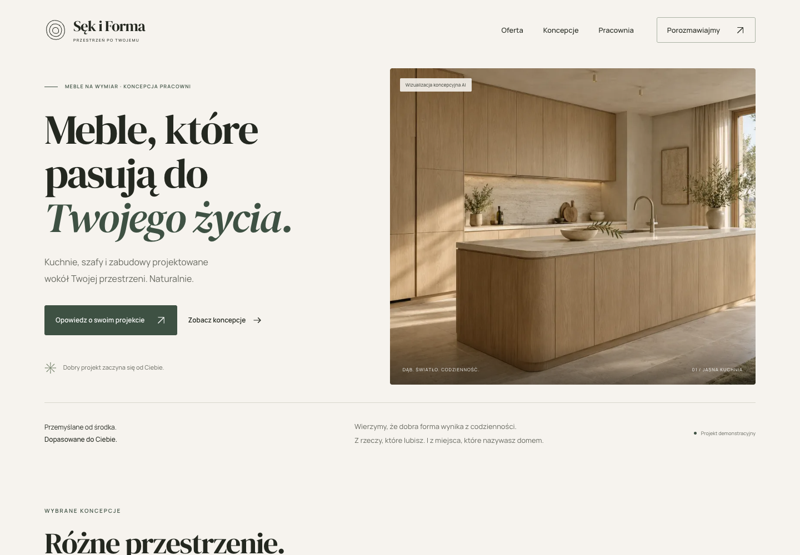

# Sęk i Forma

**[Zobacz demo](https://sek-i-forma-portfolio.frostyclove2.chatgpt.site)** · [Kod na GitHubie](https://github.com/JakubLewosz/sekiforma)

Demonstracyjna strona fikcyjnej pracowni mebli na wymiar. Projekt portfolio Jakuba Lewosza: spokojny katalog wnętrz, dopracowana wersja mobilna i interaktywny brief. Implementacja, teksty oraz kontrola jakości zostały rozwinięte z pomocą Codexa; wizualizacje wnętrz przygotowano w ImageGen.

Repozytorium: [github.com/JakubLewosz/sekiforma](https://github.com/JakubLewosz/sekiforma).



## Uruchomienie

Node.js **22.22.0 lub nowszy** (realizację sprawdzono na Node 24.11.0) i npm.

```bash
npm ci
npm run dev
```

Otwórz adres wypisany przez Astro, domyślnie `http://127.0.0.1:4321`.

Projekt celowo używa `trailingSlash: 'always'` i statycznych plików `*/index.html`. Kanoniczne adresy podstron kończą się `/`, np. `/kontakt/`. Testy i skrypty QA otwierają te adresy bezpośrednio; lokalny Astro może zwrócić 404 dla `/kontakt` bez końcowego ukośnika. Normalizacja takich adresów na publicznej stronie zależy od hostingu.

```bash
npm run check     # TypeScript i szablony Astro
npm run build     # statyczne pliki w dist/
npm run preview   # podgląd wersji produkcyjnej
npm test          # testy przeglądarkowe na porcie 4322
```

Testy wykorzystują lokalny Google Chrome w standardowej lokalizacji macOS. Na innym systemie zainstaluj przeglądarkę przez `npx playwright install chromium` lub podaj pełną ścieżkę w zmiennej `CHROME_PATH`. Skrypt nagrania wymaga jednorazowo `npx playwright install ffmpeg`.

## Co działa

- Osiem adresów treściowych: strona główna, oferta, koncepcje, trzy szczegóły, pracownia i kontakt; dodatkowo własne 404.
- Trzy spójne koncepcje z opisami założeń, materiałów i decyzji. Każda ma dwa ujęcia AI i jeden opisany wycinek.
- Zróżnicowany układ strony głównej i katalogu, większa prezentacja pierwszej koncepcji i galerie z trzema obrazami.
- Interaktywna paleta dębu, kamienia i zieleni: zmiana obrazu, opisu i odnośnika, obsługa klawiaturą oraz pełna treść bez JavaScript.
- Animowane wejście nagłówka, płynne odsłanianie zdjęć i rytmiczne wejścia tekstów oraz natywne przejście zdjęcia z karty do koncepcji i z powrotem. Krótszy ruch na telefonie oraz obsługa `prefers-reduced-motion`, także podczas trwania efektu.
- Galeria obsługiwana klawiaturą, Escape i przywracanie fokusu, także na niskim ekranie; FAQ; mobilne menu z dostępem do odnośników również bez JavaScriptu.
- Trzy kroki briefu: rodzaj projektu → etap i potrzeba → przykładowe dane. Walidacja, cofanie z zachowaniem danych, podsumowanie rzeczywistych odpowiedzi, dyskretne przejście do autora w sprawie stworzenia strony internetowej oraz reset.
- Przejścia z koncepcji do formularza ze wskazanym rodzajem projektu.
- Lokalne fonty z polskimi znakami, responsywne WebP, metadane, favicon i obraz Open Graph.

## Uczciwe granice demo

**Sęk i Forma jest fikcyjną marką.** Wnętrza są wizualizacjami AI, bez przypisywania ich realnym klientom. Nie ma fikcyjnych opinii, adresu pracowni, liczb realizacji ani cen.

Formularz **niczego nie wysyła**. Używaj danych przykładowych. Odpowiedzi pozostają w stanie komponentu React; nie ma bazy, localStorage, sessionStorage, analityki ani zewnętrznego formularza. Odpowiedzi istnieją tylko w pamięci bieżącego dokumentu; ponowne załadowanie strony je usuwa. Bez JavaScriptu pola i przycisk przejścia pozostają wyłączone; metoda `dialog` dodatkowo nie inicjuje transmisji formularza.

Realny kontakt do Jakuba jest oddzielony w sekcji „O projekcie / Prawdziwy kontakt”. Email i profil GitHub pochodzą z publicznego README autora.

Demo jest opublikowane publicznie w Sites, bez logowania. Nie ma CMS, edytora dla klienta ani rzeczywistej obsługi zapytań meblowych. Demo domyślnie blokuje indeksowanie (`noindex` i `robots.txt`). Nie generuje fikcyjnych danych LocalBusiness.

## Technologia i układ

Astro 7.4.0, React 19.3.1, Tailwind CSS 4.3.3, TypeScript 6.0.3. Dokładne wersje i zależności są w `package-lock.json`. Główna treść jest statycznym HTML; React jest dołączany tylko na stronie formularza. Przejścia między dokumentami korzystają z natywnego View Transitions API. W przeglądarkach bez tej funkcji działają zwykłe odnośniki. Nie dodano routera SPA ani biblioteki animacji.

```text
src/data/projects.ts       koncepcje, proces, FAQ
src/data/materials.ts      paleta materiałów
src/pages/                 osiem adresów i 404
src/layouts/Layout.astro   wspólny dokument i metadane
src/components/            nawigacja, galeria, brief, bloki
src/styles/global.css      system i responsywność
src/assets/                lokalne WebP i detale
public/                    ikona, robots, Open Graph
src/scripts/motion.ts      wejścia zdjęć, tekstów i preferencje ruchu
src/styles/motion.css      spójny system animacji
src/styles/editorial.css   układy katalogowe i paleta
scripts/                   przygotowanie obrazów, zrzuty, audyt
```

## Sprawdzenia i materiały portfolio

Bieżąca kontrola lokalna: [nowy kontakt i zgodność tras — 21 października 2026](docs/QA-2026-10-21.md). Wyniki wcześniejszej weryfikacji publicznej wersji: [kontrola z 20 października 2026](docs/QA-2026-10-20.md). [Raport z 19 października](docs/QA.md) i jego pomiary Lighthouse są historyczne. Zrzuty desktop i mobile są w [docs/screenshots](docs/screenshots), a [krótkie nagranie](docs/video/przejscie-przez-strone.webm) pokazuje przejście od strony głównej przez podsumowanie briefu do kontaktu z autorem.

Dodatkowe narzędzia:

```bash
npm run format
node scripts/prepare-assets.mjs
npm run qa:capture   # wymaga działającego preview na 4322
npm run qa:audit     # wymaga preview na 4322 i lokalnego Chrome
node scripts/capture-motion.mjs # nagrania animacji desktop i mobile
node scripts/capture-scroll.mjs # animowane wejścia podczas przewijania
node scripts/capture-materials.mjs # paleta i drugie ujęcia
node scripts/measure-page-weights.mjs # rozmiary stron koncepcji
```

Zdjęcia płynnie się odsłaniają i delikatnie oddalają do docelowego kadru. Stan początkowy przygotowuje się poza ekranem, a obrazy są wcześniej dekodowane. Widoczna już treść nie jest ponownie wygaszana; efekty nie powtarzają się przy powrocie. Karty mają subtelny zoom po najechaniu. Nagrania przewijania: [desktop](docs/video/scroll-desktop.webm) i [mobile](docs/video/scroll-mobile.webm).

Nagrania systemu ruchu: [desktop](docs/video/animacje-desktop.webm) i [mobile](docs/video/animacje-mobile.webm). Paleta i dodatkowe ujęcia: [desktop](docs/video/materialy-i-ujecia-desktop.webm) i [mobile](docs/video/materialy-i-ujecia-mobile.webm).

Dokumentacja:

- [Zakres](docs/BRIEF.md) i [oryginalny plan](docs/PLAN-ZRODLOWY.txt).
- [System wizualny i decyzje](docs/DESIGN.md).
- [Materiały, źródła, licencje i prompty](docs/ASSETS.md).
- [Aktualne wyniki kontroli jakości](docs/QA-2026-10-20.md) i [archiwum z 19 października](docs/QA.md).
- [Publikacja i aktualizacja demo](docs/DEPLOYMENT.md).

## Publiczne demo i aktualizacja

Publiczną wersję sprawdzono na 8 podstronach i ich odświeżeniach, z formularzem, galerią, paletą, zasobami i własnym 404. [Rzeczywisty wynik kontroli](docs/qa-public-2026-10-20.json).

Demo działa pod adresem [sek-i-forma-portfolio.frostyclove2.chatgpt.site](https://sek-i-forma-portfolio.frostyclove2.chatgpt.site). Konfigurację statycznego hostingu Sites zapisano w `.openai/hosting.json`. `SITE_URL` wskazuje ten origin; można go nadpisać przy przeniesieniu strony. Pełne adresy canonical i Open Graph są generowane podczas buildu. Celowe `noindex` i oznaczenia demo pozostają aktywne.

Instrukcja: [docs/DEPLOYMENT.md](docs/DEPLOYMENT.md). Pełny projekt i materiały portfolio są na GitHubie; Sites otrzymuje lekki katalog źródeł z informacją o odpowiadającym commicie. Sam push do GitHuba nie uruchamia wdrożenia.

```bash
node scripts/verify-demo.mjs  # kontrola publicznego serwisu
npx playwright install webkit
PW_BROWSER=webkit QA_REPORT=docs/qa-webkit-2026-10-20.json npm test -- tests/portfolio.spec.ts tests/materials.spec.ts tests/site.spec.ts --grep 'nawigacja|paleta|trzy widoki|brief:|galeria:|każda koncepcja|menu mobilne'
```

Przed użyciem dla rzeczywistego klienta trzeba zastąpić treści i obrazy, ustalić obsługę zapytań i utrzymanie. Bieżące demo nie zbiera zapytań meblowych; kontakt do Jakuba dotyczy tworzenia stron internetowych.

## Opis do portfolio

> Projekt demonstracyjny strony pracowni mebli na wymiar. Przygotowałem koncepcję, interfejs responsywny, prezentację projektów i interaktywny brief. Implementację rozwijałem z pomocą Codexa; zakres i wyniki sprawdzeń opisuję w repozytorium. Wnętrza są wizualizacjami AI, a formularz nie wysyła danych.
